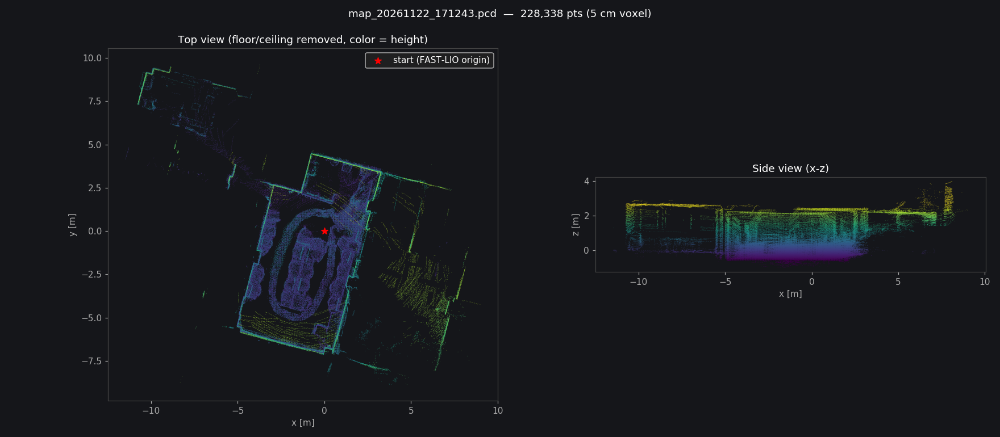

# Unitree Go2 EDU Plus — 강화학습 기반 미지 환경 탐사

Unitree Go2 EDU Plus에 **Hesai PandarXT-16**(3D LiDAR)과 **Intel RealSense D435i**를 얹어
**처음 보는 재난 실내에서 사람을 찾는** 연구 프로젝트입니다. 낮은 틈은 몸을 낮춰 통과하고, 만난 사람의 제보로 탐색 순서를 바꿉니다.

- **실로봇** (이 문서): 3D SLAM → 자율주행(Nav2). 로봇에 탑재된 **Jetson Orin NX**에서 실행합니다.
- **시뮬레이션·강화학습**: [sim/README.md](sim/README.md). 학습 PC(RTX 3090, Isaac Lab)에서 실행합니다.

최종 갱신: **2026-11-24**


<sub>FAST-LIO2로 직접 매핑한 실내 지도 (Hesai XT16 + Go2 IMU, 5 cm voxel, 약 23만 점)</sub>

---

## 진행 상황

### 강화학습·탐사 (시뮬레이션)

| 단계 | 상태 | 비고 |
|---|---|---|
| Go2 + XT16 + D435i 모델 | ✅ 완료 | 손잡이·독 등은 실측 대기 |
| HiPAN 하위 보행 teacher | 🔄 학습 중 | 논문 구조로 재작성 (`sim/go2_lab/hipan_low.py`) |
| (이전) 낮춰 걷기 정책 1–5단계 | ⏹ 대체됨 | teacher 2단계 완료: base 0.122 m까지 보행, 머리 접촉까지 세면 스트레스 넘어짐 12 % (student) → 4단계 2–3 %, 저속 보행은 개선 중 |
| 2D 탐색에서 제보·틈 연동 | ✅ 완료 | 분리 방식보다 21.5 / 24.0 % 빠름 |
| 제보 해석 (Qwen3-VL-8B) | 🔄 1차 완료 | 말 해석만 맡길 때, 큰 건물에서 이득 |
| student 증류 | 🔄 1차 완료 | 선속도 없이 동작. 3·4단계 미채택, 5단계 학습 중 |
| 논문 정독 | 🔄 진행 중 | [docs/papers](docs/papers/README.md), HiPAN 완료 |
| HiPAN식 상위 항법 (teacher → depth student) | ⬜ 예정 | |
| 목표점 선택 (3D 지도 커버리지 + 텍스트, 가중치 학습) | ⬜ 예정 | |
| 실로봇 틈 통과 | ⬜ 예정 | |

### 실로봇

| 단계 | 상태 | 비고 |
|---|---|---|
| 하드웨어·네트워크 파악 | ✅ 완료 | 아래 [하드웨어](#하드웨어-구성) / [네트워크](#네트워크--통신) |
| Go2 ROS2 메시지 (`unitree_go`, `unitree_api`) 빌드 | ✅ 완료 | `/lowstate`, `/sportmodestate`, `/utlidar/*` 수신 확인 |
| Hesai XT16 ROS2 드라이버 | ✅ 완료 | `/lidar_points` 10 Hz |
| RealSense D435i ROS2 드라이버 | ✅ 완료 | 컬러·깊이 15 fps, `/camera/depth/points` |
| CycloneDDS 대역폭 문제 해결 | ✅ 완료 | [트러블슈팅](docs/troubleshooting.md#1-dds-토픽-속도-붕괴) |
| 센서 TF 캘리브레이션 (Hesai·RealSense) | ✅ 완료 | 점군 정합으로 검증, [TF](#센서-장착-위치-tf) |
| 3D LIO 실시간 매핑 (FAST-LIO2) | ✅ 완료 | rviz 실시간 확인, PCD 저장 |
| 루프 클로저 (전역 지도 보정) | ⏳ 다음 단계 | 출발점 복귀 오차 0.4~0.7 m, z 드리프트 보정 필요 |
| 2D 점유 격자 지도 생성 | ⬜ 예정 | 3D 지도 → Nav2용 2D map |
| Nav2 자율주행 (`/cmd_vel` → Go2 Sport API) | ⬜ 예정 | 장애물: Hesai + RealSense |

---

## 하드웨어 구성

| 장비 | 장착 위치 | 연결 | 용도 |
|---|---|---|---|
| Unitree Go2 EDU Plus 메인보드 | 몸체 내부 | 유선 LAN (192.168.123.161) | 보행 제어, 몸체 IMU, 내장 센서 |
| └ 내장 L1 4D LiDAR | 턱 아래 (뒤집혀 장착) | 메인보드 경유 | 사용 안 함 (아래 참고) |
| └ 내장 전면 카메라 | 머리 앞 | 메인보드 경유 | `/frontvideostream` (~4 Hz) |
| **Jetson Orin NX** (확장 독) | 몸체 위 | eth0 192.168.123.18 | 모든 ROS2 처리 (이 저장소) |
| **Hesai PandarXT-16** | 몸체 위 앞쪽 플레이트 | 유선 LAN (192.168.123.20) | SLAM 주 센서 |
| **Intel RealSense D435i** | 머리 위 브라켓 | Orin NX USB 3.0 | Nav2 근거리 장애물 (예정) |

**소프트웨어:** JetPack 5.1.1 (L4T R35.3.1) · Ubuntu 20.04 · **ROS2 Foxy** (+ ROS1 Noetic 설치됨) · CycloneDDS 0.10.x

> **내장 L1 LiDAR를 쓰지 않는 이유:** `/utlidar/cloud`를 Go2 공식 URDF(`radar_joint`)로 변환해도 Hesai 점군과
> 정합되지 않았습니다(중앙 오차 0.42 m, 8 cm 이내 4 %). 프레임 이름과 실제 좌표계가 다른 것으로 보이며,
> SLAM·내비게이션은 Hesai + RealSense로 진행하기로 결정했습니다.

---

## 네트워크 / 통신

```
                 ┌──────────────────────────────────────────┐
                 │ Go2 메인보드        192.168.123.161      │
                 │  /lowstate (IMU·관절) ~500 Hz            │
                 │  /sportmodestate     ~290 Hz             │
                 │  /utlidar/*, /frontvideostream, /api/*   │
                 └──────────────┬───────────────────────────┘
                                │  유선 LAN 192.168.123.0/24  (CycloneDDS, ROS2 domain 0)
┌───────────────────────────────┴───────────────┐
│ Jetson Orin NX          192.168.123.18 (eth0) │──── Hesai PandarXT-16   192.168.123.20
│  ROS2 Foxy / rmw_cyclonedds_cpp               │      UDP 2368 (점군) → .18
│  FAST-LIO2, 드라이버, rviz2                   │      TCP 9347 (PTC), HTTP 80 (웹 설정)
└──────────┬────────────────────────────────────┘
           │ USB 3.0
     RealSense D435i
```

| 장치 | IP | 비고 |
|---|---|---|
| Go2 메인보드 | `192.168.123.161` | Unitree DDS 토픽 발행 |
| Jetson Orin NX | `192.168.123.18` | eth0. (Wi-Fi·원격 접속 주소는 보안상 생략) |
| Hesai XT16 | `192.168.123.20` | 웹 설정: `http://192.168.123.20` · 목적지 `192.168.123.18:2368` |

**통신 방식**

- **Go2 ↔ NX:** Go2는 ROS2 노드가 아니라 순수 CycloneDDS 앱이지만 ROS2와 같은 DDS 토픽 이름을 써서,
  `unitree_go` 메시지 패키지만 빌드하면 `ros2 topic echo /lowstate`로 바로 읽힙니다.
  Go2 펌웨어와 맞추기 위해 CycloneDDS **0.10.x** 기반 `rmw_cyclonedds_cpp`를 소스 빌드해 사용합니다 (Foxy 기본 0.7.x는 호환 안 됨).
- **DDS 설정 ([cyclonedds.xml](cyclonedds.xml)):** `eth0` 고정 + `AllowMulticast=spdp`
  (멀티캐스트는 장치 탐색에만, 데이터는 유니캐스트). 이렇게 해야 NX 내부의 카메라·점군 트래픽이
  Go2 랜선으로 새어나가지 않습니다. 커널 UDP 수신 버퍼도 32 MB로 확장 ([config/60-dds-buffers.conf](config/60-dds-buffers.conf)).
- **Hesai → NX:** 순수 UDP 패킷(568 B, ~5,000 pkt/s)을 Hesai ROS2 드라이버가 `/lidar_points`로 변환.
  LiDAR 내부 시계가 동기화되어 있지 않아(PTP Free Run, 2020년으로 표시) **수신 시각 기준 타임스탬프**(`use_timestamp_type: 1`)를 사용합니다.

---

## 센서 장착 위치 (TF)

```
camera_init (FAST-LIO 월드)
 └─ body  (= Go2 몸체 IMU, FAST-LIO가 발행)
     └─ base_link            (−0.02557, 0, +0.04232)의 역변환  [Go2 URDF imu_joint]
         ├─ hesai_lidar      x 0.1454  y 0  z 0.1331   yaw +90°
         └─ camera_link      x 0.32    y 0  z 0.055    pitch +13° (아래로)
```

| 프레임 | 값 (base_link 기준) | 결정 방법 |
|---|---|---|
| `hesai_lidar` | (0.1454, 0, 0.1331), **yaw +90°** | 위치: 동일 구성(Go2 + XT16) 공개 extrinsic `(0.171, 0, 0.0908)` + URDF IMU 오프셋. 바닥 높이로 검증. **yaw**: RealSense 점군 대조로 측정 (0°일 때 정합 0 % → +90°에서 약 75 %) |
| `camera_link` | (0.32, 0, 0.055), pitch 0.227 rad | z·pitch: 깊이 영상 바닥 평면 RANSAC 피팅 (바닥 위 ~0.40 m, 아래로 ~13°). x: 사진 + URDF 머리 위치 추정 |
| FAST-LIO extrinsic (LiDAR in IMU) | T = (0.17097, 0, 0.09078), R = Rz(+90°) | 위 두 값의 조합 → [config/fastlio_go2_xt16.yaml](config/fastlio_go2_xt16.yaml) |

> ⚠️ 이 로봇의 XT16은 점군 **+y축이 로봇 정면**입니다. 다른 Go2+XT16 예제의 회전 없는(identity) 설정을 그대로 쓰면 지도가 90° 틀어집니다.

---

## 저장소 구조

```
.
├── env.sh                    # ROS2 환경 일괄 설정 (source env.sh)
├── cyclonedds.xml            # DDS 설정 (eth0, spdp-only multicast, 16 MB rx buffer)
├── start_sensors.sh          # Hesai + RealSense 드라이버  (--no-realsense 옵션)
├── view_all.sh               # 센서 + 정적 TF + rviz (센서 정합 확인용)
├── slam_mapping.sh           # 실시간 3D 매핑: Hesai + IMU 브리지 + FAST-LIO2 + 맵 누적기 + rviz
├── config/
│   ├── fastlio_go2_xt16.yaml # FAST-LIO2 설정 (Hesai XT16 + Go2 IMU)
│   ├── hesai_xt16_config.yaml# Hesai 드라이버 설정 (IP, 수신시각 타임스탬프)
│   └── 60-dds-buffers.conf   # /etc/sysctl.d/ 용 UDP 버퍼 설정
├── launch/
│   ├── slam_lio.launch.py    # IMU 브리지 + FAST-LIO2 + 맵 누적기 + TF + rviz
│   └── rs_depth_points.launch.py  # D435i 깊이 → 점군 (depth_image_proc)
├── rviz/                     # all_sensors.rviz, slam_lio.rviz
├── ros2_ws/src/              # 직접 작성한 ROS2 패키지
│   ├── go2_imu_bridge/       # /lowstate → /go2/imu (sensor_msgs/Imu, ~400 Hz)
│   ├── go2_map_tools/        # map_accumulator: 복셀 지도 누적 · /map_cloud · PCD 저장 서비스
│   └── livox_ros_driver2/    # 메시지 전용 스텁 (FAST-LIO 빌드 의존성 해결용)
├── patches/
│   └── fast_lio_hesai_foxy.patch  # FAST-LIO(ROS2) 수정분: Hesai 입력 처리 + Foxy 호환
├── maps/                     # 직접 딴 지도 (.pcd)
├── tools/                    # render_map_preview.py, install_korean.sh
├── sim/                      # 시뮬레이션·강화학습 (sim/README.md)
└── docs/                     # setup.md, troubleshooting.md, images/
```

---

## 실행 방법

설치·빌드는 [docs/setup.md](docs/setup.md) 참고.

```bash
# 1) 센서만 확인 (Hesai + RealSense + rviz)
./view_all.sh

# 2) 실시간 3D 매핑 (rviz에서 지도가 쌓이는 것 확인)
./slam_mapping.sh                    # RealSense 없이 (기본)
./slam_mapping.sh --with-realsense   # RealSense 같이

# 3) 지도 저장 (다른 터미널)
source env.sh
ros2 service call /map_accumulator/save_map std_srvs/srv/Trigger
#   → maps/map_YYYYmmdd_HHMMSS.pcd

# 지도 미리보기 이미지
python3 tools/render_map_preview.py maps/<map>.pcd docs/images/<map>.png
```

**매핑 팁:** 시작 후 2~3초는 로봇을 정지 (IMU 초기화) · 천천히 보행 · 가능하면 출발점으로 복귀 · 도중에 앉히지 않기.

### 주요 토픽

| 토픽 | 타입 | 발행 | 주기 |
|---|---|---|---|
| `/lidar_points` | PointCloud2 | Hesai 드라이버 | 10 Hz |
| `/go2/imu` | Imu | go2_imu_bridge | ~400 Hz |
| `/Odometry`, `/path` | Odometry, Path | FAST-LIO2 | 10 Hz |
| `/cloud_registered` | PointCloud2 | FAST-LIO2 (월드 좌표 스캔) | 10 Hz |
| `/map_cloud` | PointCloud2 | map_accumulator (10 cm 복셀 전역 지도) | 0.5 Hz |
| `/camera/depth/points` | PointCloud2 | depth_image_proc | ~12 Hz |
| `/lowstate`, `/sportmodestate` | unitree_go | Go2 | ~500 / ~290 Hz |

---

## 지도 기록

| 파일 | 날짜 | 경로 길이 | 출발점 복귀 오차 | 비고 |
|---|---|---|---|---|
| [maps/map_20261122_171243.pcd](maps/map_20261122_171243.pcd) | 2026-11-22 | 18.2 m | 0.72 m | FAST-LIO2 단독 (루프 클로저 없음), 실내 사무실 1바퀴 |

---

## 알려진 문제 / 다음 할 일

- **z 드리프트:** 평지 보행 중 추정 높이가 −0.30 ~ +0.09 m 범위로 출렁임 (위 Side view에서 바닥이 두껍게 쌓인 원인).
  → 루프 클로저 + 지면 제약, IMU 노이즈 파라미터 튜닝 예정.
- **출발점 복귀 오차** 0.4~0.7 m (경로 18~25 m) → 루프 클로저로 보정 예정.
- **발열:** 장시간 구동 시 CPU ~74 °C, 팬 최대. 매핑 시 RealSense를 끄고, 원격 데스크톱(RustDesk, CPU ~265 %)은 필요할 때만 사용.
- 상세 문제 해결 기록: [docs/troubleshooting.md](docs/troubleshooting.md)
