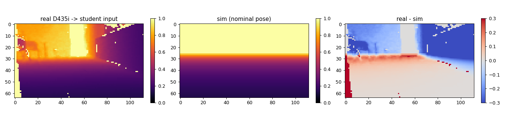
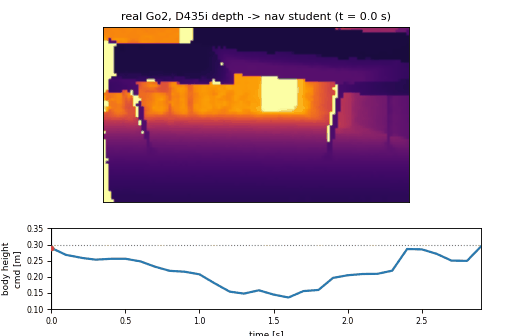
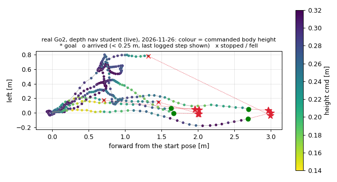

# 실로봇 첫 시험: HiPAN 하위 보행 student (2026-11-26)

시뮬레이션(Isaac Lab)에서만 학습한 하위 보행 student를 실제 Go2에 그대로 올렸다. 실로봇 데이터로 추가 학습하거나 튜닝하지 않았다 (zero-shot).
실로봇 데이터는 발 접촉 판정 기준값을 정하는 데만 썼다.

## 실행 구조

```
/lowstate (Go2 메인보드, 500 Hz) ──→ go2_hipan_low (C++, NX, 50 Hz 실시간 스레드)
                                     관측 62 × 50스텝 → MLP → 관절 목표 → /lowcmd (PD Kp 25 / Kd 0.5)
리모컨 (lowstate.wireless_remote) ──┘  또는 /hipan/cmd (상위 항법용)
```

- 정책 가중치: `deploy/weights/hipan_low_student.bin` (`sim/weights/go2_hipan_low_student.pt`에서 변환)
- 검증
  - C++ 출력과 원본 torch 출력의 차이: 7×10⁻⁷
  - 한 번 계산: 0.59 ms
  - 제어 주기: p99 20.02 ms (Python 구현은 최대 52 ms라 C++로 옮김)
- 관절 순서
  - 정책(Isaac): 엉덩이 4 → 허벅지 4 → 종아리 4, 다리 순서 FL FR RL RR
  - Unitree SDK: 다리별(FR FL RR RL) 엉덩이·허벅지·종아리
  - 변환표는 `hipan_policy.hpp`의 `kIsaacToSdk`

## 조작과 안전

| 상태 | 입력 | 동작 |
|---|---|---|
| 시작 (엎드림) | 자동 | 3초 동안 일어섬 (Kp 50 / Kd 3) |
| 서서 유지 | **start** | 보행 정책 시작. 1초 동안 게인을 학습 값(Kp 25 / Kd 0.5)으로 전환 |
| 보행 중 | 왼쪽 스틱 / 오른쪽 스틱 / 방향키 | 이동 / 회전 / 높이 ±2 cm, roll ±0.05 rad |
| 보행 중 | **L2+A** | 정책 정지 → 1초 동안 기본 자세로 복귀 |
| 서서 유지 | **L2+A** | 앉기. 0.18 m까지 1.8초, 그 아래는 2.2초 동안 천천히 |
| 엎드림 | **L2+A** | 다시 일어섬 |
| 언제든 | **L2+B** | 비상정지 (감쇠 Kd 4) |
| 자동 | 기울기 0.8 rad 초과, `/lowstate` 100 ms 끊김, 관절 한계 초과, 출력 이상 | 비상정지 |

- 종료는 반드시 `deploy/stop_hipan_low.sh`로 한다. 노드가 기본 자세 → 앉기를 거친 뒤 스스로 꺼진다.
- **서 있을 때 노드를 강제로 끄면 로봇이 주저앉는다.** 이번 시험 중 한 번 실제로 그렇게 됐다.
- 엎드린 자세:
  - 뒷다리 엉덩이: 바깥쪽 ±0.40 rad (Unitree 내장 엎드린 자세와 같음)
  - 앞다리 엉덩이: 안쪽 ±0.10 rad
  - 앞다리 허벅지·종아리: 조금 덜 접음
  - 이렇게 해야 턱 아래 L1 LiDAR가 바닥에 닿지 않는다. 동시에 같은 속도로 접으면 몸 높이 약 0.16 m에서 LiDAR가 먼저 바닥에 닿았다 (앞발 접촉이 떨어지는 것으로 확인).

## 센서 실측

| 항목 | 실측 | 시뮬레이션 student 관측 노이즈 |
|---|---|---|
| 관절각 노이즈 (정지) | 0.013 rad | ±0.01 |
| 관절속도 노이즈 | 0.08 rad/s | ±1.5 (×0.05) |
| IMU roll/pitch 흔들림 | ±0.004 rad | ±0.05 |
| 자이로 노이즈 | 0.02 rad/s | ±0.2 |
| `/lowstate` 지연 | p99 1–2 ms | 제어 지연 0–20 ms로 학습 |

**`foot_force`** (원시값, 단위 없음)
- 하중 없음: 12–15. 발마다 다르고, 15초 동안 드리프트 없음.
- 디딤: 25–208 (중앙값 37–60).
- 접촉 판정 기준값 **20**: 걷는 동안 관절각으로 계산한 발 높이와 98.5 % 일치.

**리모컨** (`wireless_remote` 바이트, `/wirelesscontroller`와 대조해 상관 1.000)
- lx: byte 4, rx: byte 8, ly: byte 20
- 버튼: byte 2–3. L2 = bit 5, A = 8, B = 9, start = 2

## 보행 결과

- 서기, 전진·후진, 옆걸음, 회전 모두 넘어짐 없이 동작. 정책 실행 182초 동안 안전장치 작동 0회.
- 최대 기울기: roll 0.24, pitch 0.14 rad.
- **속도 추종** (FAST-LIO 실측, 19초 주행)

| 축 | 실측 / 명령 | 상관 | 지연 |
|---|---|---|---|
| 전진·후진 vx | 0.70 | 0.97 | 0.20 s |
| 회전 ωz | 0.69 | 0.98 | 0.08 s |
| 옆걸음 vy | 약 0.5 (표본 적음) | 0.51 | |

- 시뮬레이션에서는 0.4 m/s 명령에 0.35 m/s(0.87배)였다. 실제는 더 느리다.

**정책 자신의 추정** (상위 항법 student 입력에 들어가는 값)

| 항목 | 결과 |
|---|---|
| 속도 | FAST-LIO와 비교해 편향 0, 오차 0.07 m/s |
| 높이 | 0.310 m (명령 0.30) |
| roll | IMU와 차이 0.007 rad |

**발견한 문제**
- 회전·옆걸음 때 발을 들지 않고 바닥에 붙인 채 끌듯이 움직인다. 걷는 동안 발이 공중에 있는 비율이 11–25 %다.
- 원인: HiPAN Table III 보상에는 발 공중 시간이나 미끄러짐 항이 없고, 관절 속도·토크·행동 변화 벌점만 있어서 끌기가 더 싸다.
- 허벅지 토크가 최대 26.4 Nm까지 나왔다. 시뮬레이션 모터 모델 상한 23.7 Nm보다 크다.

## D435i depth: 실제 vs 시뮬레이션



<sub>빈 바닥 장면: 실제 depth를 student 입력으로 바꾼 것(왼쪽), 설계 자세의 시뮬레이션 바닥(가운데), 차이(오른쪽). 바닥 부분은 일치하고, 왼쪽 가장자리 빈 띠와 지평선 위치(기울기 차이)가 다르다.</sub>

| 항목 | 실제 | 시뮬레이션 | 조치 |
|---|---|---|---|
| 해상도·시야 | 640×480이면 79×64° | 112×64, 87×58° | **848×480으로 변경 → 89.5×58.6°** (`start_sensors.sh --rs-sim`) |
| 카메라 아래 기울기 (바닥 평면 RANSAC) | 10.3° (몸 기울기 포함, 장착 약 11.6°) | 13° | 시뮬레이션 수정 + ±4° 무작위화 예정 |
| 카메라 높이 | 0.395 m | 0.381 m | 무작위화 범위 안 |
| 빈 픽셀 | 약 5 %. 왼쪽 가장자리 띠(1 m에서 student 입력 4칸, 가까울수록 넓어짐)와 물체 테두리 선 | 0 % | 시뮬레이션에 추가 예정. 빈 픽셀은 student 입력에서 "4 m(멀다)"가 됨 |
| 노이즈 | 1 m에서 6 mm, 1–4 m에서 약 19 mm | 0 | 거리 제곱에 비례하는 노이즈 추가 예정 |
| 머리 위 장애물 (책상, 상판 0.65–0.9 m) | 0.7–1.3 m 앞에서 선명하게 보임 | | |

## depth 항법 student 실로봇 실행

구성: `deploy/run_hipan_nav.py` (10 Hz, numpy) → `/hipan/cmd` → `go2_hipan_low` (`cmd_source:=topic`, 스틱을 움직이면 즉시 수동).

- **입력을 시뮬레이션과 맞춘 방법**
  - depth 848×480에서 시뮬레이션 시야 87×58°만큼 잘라냄. 실제 장착 기울기가 1.4° 덜 숙여져 있어서 그만큼 아래쪽으로 옮겨 자름.
  - 블록별 유효 픽셀 중앙값으로 64×112로 줄임. 빈 블록은 4 m.
  - 목표점은 FAST-LIO 위치 기준 (로봇 기준 x/5, y/5, 거리/10).
  - 하위 정책 관측 62개와 운동 상태 추정 5개는 `/hipan/debug`에서 받음.
- **실행 정책**: v2 student (2,500회 중간본). numpy 계산이 torch 원본과 같음 (오차 2×10⁻⁷), NX에서 한 번 3.4 ms, depth 변환 11 ms.
- **섀도 확인**: 앞 0.5 m에 장애물이 있을 때 실제 depth로는 후진·회전, 같은 순간 빈 바닥 depth로 바꾸면 전진 → depth를 보고 판단함.

 

| 실행 | 결과 | 시간 | 경로 / 직선 | 숙인 비율 (h<0.26) | 최저 높이 |
|---|---|---|---|---|---|
| 2 m #1 (처음 지형) | 1 m에서 넘어짐 (roll 0.13 + 빠른 복합 명령) | | | | |
| 2 m #2 (지형 쉽게) | 사용자 정지 | 1.9 s | 0.78 / 0.73 m | 95 % | 0.15 m |
| 2 m #3 | **도착** | 2.9 s | 1.69 / 1.64 m | 80 % | 0.14 m |
| 2 m #4 | **도착** | 6.7 s | 1.99 / 1.67 m | 28 % | 0.17 m |
| 3 m #1 | **도착** | 16.7 s | 4.98 / 2.69 m | 16 % | 0.17 m |
| 3 m #2 | L2+B 정지 | 2.9 s | 1.64 / 1.53 m | 23 % | 0.20 m |
| 3 m #3 | **도착** | | | | |

- 2 m #3 (위 GIF): 출발 때 화면 위쪽에 가까운 머리 위 장애물이 보였다. 1.6 s에 0.14 m까지 숙였고, 장애물이 화면에서 사라진 뒤에도 숙인 채 지나갔다 (GRU 기억). 2.5 s에 0.30 m로 다시 섰다.
- **남은 문제**
  - 명령 속도가 0.9–1.0 m/s로 빠름. 원하는 속도 입력 0.3이 거의 반영되지 않음.
  - 기울어진 틈이 없는데 roll을 0.2–0.28 rad 줌.
  - 3 m #1에서 경로가 직선의 1.85배 (회전 명령 평균 0.75 rad/s).
  - 0.1 s마다 명령이 크게 바뀜.
  - 원인 후보: 시뮬레이션 하위 정책이 실제보다 명령을 잘 따라감, 속도 보상 약함, 명령 변화 벌점 약함, 실제 depth 빈 픽셀·노이즈.
  - 명령을 바깥에서 자르는 대신 학습에서 고친다 (`run_hipan_nav.py`의 제한 옵션은 기본 꺼짐).

## 발 센서 영점 드리프트와 왼쪽 뒷다리

- 정책으로 서 있을 때 RL `foot_force` 중앙값이 14였다 (기준값 20 미만 → 대부분 "떠 있음"). 같은 로봇이 내장 보행기로 서 있을 때는 54였다.
- 정책이 RL을 떠 있다고 보고 하중을 덜 실어, RL이 힘없이 비틀거렸다.
- 하중 없을 때 값도 시간이 지나거나 넘어진 뒤에 바뀌었다 (오전 12–15 → 저녁 3–11).
- 조치
  - 노드 시작 시 엎드린 상태에서 발별 기본값을 재서 기준값을 "기본값 + 5"로 둔다. 보정 뒤 정책으로 서 있을 때 RL 접촉 98 %, RL 센서 값 40.
  - v3 student는 발 접촉 입력을 아예 쓰지 않는다.
- 모터는 정상이다. 같은 로봇이 내장 보행기로는 문제없이 걸었다.

## 다음

1. 하위 보행 v3 (`Go2-HiPAN-Low-V3`, 학습 중)
   - student 발 접촉 입력 제거
   - 정지 중 관절 움직임 벌점, 정지 명령 20 %
   - 양수 공중 시간 보상(0.12 s), 미끄러짐 −0.2, 속도 추종 폭 0.15
   - 모터 게인 ±25 %
   - 학습 후 실로봇
2. 상위 항법
   - 새 하위 student 위에서 teacher 이어 학습
   - 위 depth 차이를 넣어 student 재증류
   - 실로봇에서 섀도 → 실제 실행
3. 실측 남은 것
   - 숙여 걷기 (방향키), roll, 제어 지연 여유, 외란·바닥 종류, 장시간 운용, 관절 응답(시스템 식별)
