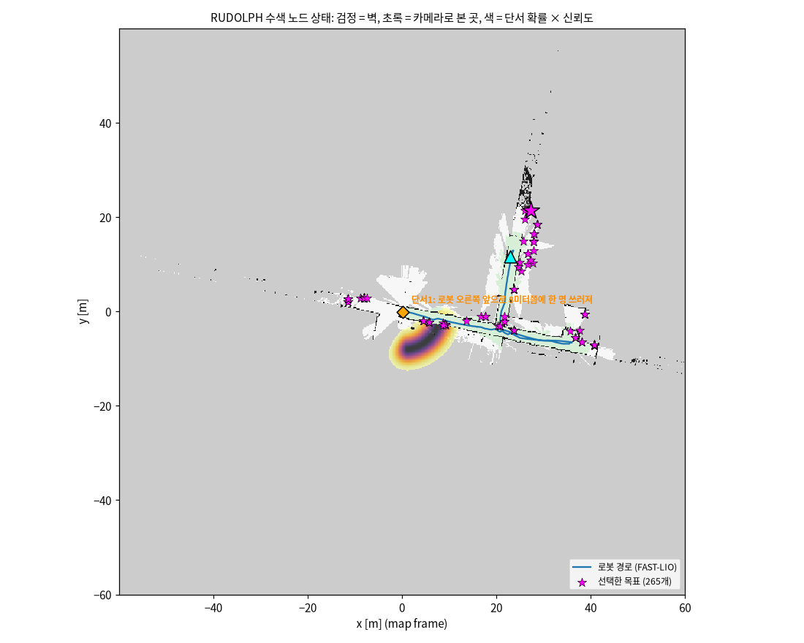

# RUDOLPH 수색 노드: 텍스트 단서 → 다음 목표점 (실로봇)

사람이 **텍스트로** 단서를 주면(마이크·대화는 나중), NX의 수색 노드가 FAST-LIO 지도 위에서 다음에 갈 곳을 골라 HiPAN 상위 항법(`/goal_pose`)에 넘긴다.
방향 단서는 **항상 로봇 기준**(문장이 들어온 순간 로봇의 정면이 0°, 오른쪽 90°)이다.

```
텍스트 ─(Wi-Fi)→ 5090 파싱 서버 (Qwen3-VL-8B, 프롬프트 v3f, ~1.5 s) ─→ 단서 JSON
FAST-LIO /cloud_registered, /Odometry ─→ LiveGrid (0.2 m 2D 격자) ─→ LiveSearch ─→ /goal_pose ─→ run_hipan_nav.py
                                          카메라 시야 = 본 곳 / 단서 확률 지도 × 신뢰도 / 경계 후보 점수
```

| 파일 | 내용 |
|---|---|
| `sim/clue/serve_parse.py` | 파싱 HTTP 서버 (`POST /parse {"text": ...}`), 5090에서 실행 |
| `sim/clue/live.py` | `LiveGrid` (실시간 2D 격자), `LiveSearch` (시뮬레이터 `Search`와 같은 판단 코드를 실제 입력으로) |
| `deploy/rudolph_search.py` | ROS2 노드 (NX, foxy, python 3.8) |
| `deploy/record_scans.py`, `deploy/offline_search.py`, `deploy/render_rudolph_state.py` | 스캔 녹화 → 오프라인 재실행 → 그림 |
| `sim/scripts/test_live_sim.py` | 2D 시뮬레이터에서 `LiveSearch` 검증 |

## 실행

```bash
# 5090 (연구실 PC): 파싱 서버
cd ~/3DDOG/RUDOLPH/sim && env -u PYTHONPATH ~/miniconda3/envs/packr/bin/python -m clue.serve_parse --port 8765

# NX: SLAM + 하위 보행 + 상위 항법이 돌고 있는 상태에서
cd ~/Desktop/3DOG/deploy && source ../env.sh
python3 rudolph_search.py            # 시험: 목표를 /rudolph/goal 에만 (rviz)
python3 rudolph_search.py --live     # 실제: /goal_pose 로 보내서 걸어감

# 단서 입력 / 사람 발견 알림
ros2 topic pub --once /rudolph/clue_text std_msgs/String "data: '로봇 오른쪽으로 5미터쯤 한 명 있어요'"
ros2 topic pub --once /rudolph/victim_here std_msgs/Empty "{}"     # 로봇 위치에서 발견
# rviz "Publish Point" (/clicked_point): 클릭한 곳에서 발견
```

rviz: `/rudolph/map`, `/rudolph/searched`, `/rudolph/belief` (OccupancyGrid), `/rudolph/goal`, `/rudolph/status`. 이벤트 기록은 `deploy/logs/rudolph_*.jsonl`.

## 2D 격자 (`LiveGrid`)

- 바닥: 스캔마다 로봇 3 m 안, 몸보다 0.15–1.2 m 아래 점들의 10번째 백분위. FAST-LIO z가 한 번 걷는 동안 −0.1 → +0.6 m 흘러서 지도 전체에 바닥 높이 하나를 쓰면 안 됨
- 장애물: 바닥 + 0.12–0.5 m 점이 3번 이상, 그리고 그 칸을 지나간 광선 수의 25 % 이상. 뒤따라 걷던 사람처럼 잠깐 있던 물체는 나중에 광선이 지나가며 지워짐
- 빈 칸: 광선이 2번 이상 지나갔거나 바닥이 보인 칸, 로봇이 밟은 자리
- 계획은 지도에서 본 영역 + 2 m 안에서만 (120 m 정사각형 전체를 계산하면 NX에서 1초 이상)

## 시험 결과

- 시뮬레이터 (건물 40개, 방향·거리 단서): `LiveSearch`가 기존 `Search`와 같거나 조금 빠름 (맞는 단서 393 vs 410초, 1/3 틀림 393 vs 443초). 계획 범위를 본 영역으로 자른 효과
- NX → 5090 파싱: 단서 하나 1.5–1.7초
- 녹화 재생 (2026-11-25 밤 녹화, 1321 스캔): 격자 갱신 3 ms/스캔, 계획 평균 0.22초 (데스크톱 CPU). 복도는 빈 곳, 벽은 선으로, 목표는 복도 끝·갈림길의 경계에 찍힘



<sub>녹화 재생: 파란 선 = 녹화된 로봇 경로 (재생이라 목표를 따라가지 않음), ★ = 수색 노드가 고른 목표, 주황 ◆ = 단서를 들은 위치, 색 = "로봇 오른쪽 앞 8 m" 단서 확률.</sub>

## 아직 안 된 것

- "왼쪽 n번째 방" 같은 의미 단서: 실제 지도에서 방·문 찾기가 필요. 지금은 저장만 하고 확률 지도에는 안 씀
- 사람 발견: 지금은 사람이 토픽/클릭으로 알림. 머리 RGB 카메라 탐지기는 다음
- 목표 도착 후 제자리 회전(360° 보기), 낮은 틈 높이(천장 높이) 격자, 실로봇 `--live` 실행
