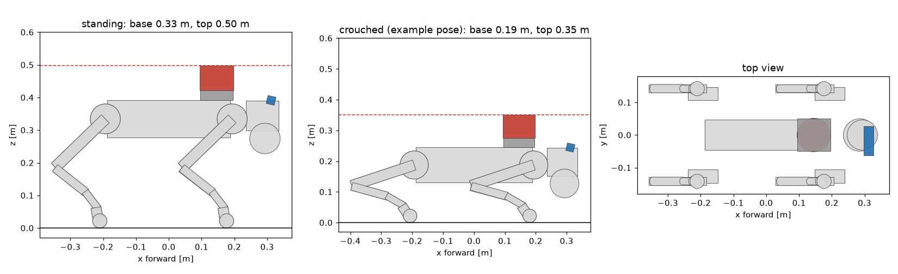

# 강화학습 기반 미지 환경 탐사 (시뮬레이션·학습)

연세대 PRAXIS 실전문제연구팀 **3DOG** · 진행 중 (최종 갱신 **2026-11-24**)

Unitree Go2 EDU Plus(Hesai XT16 + RealSense D435i)가 **처음 보는 재난 실내**에서 사람을 찾는다.
낮은 틈은 치우지 않고 **몸을 낮춰 통과**하고, 도중에 만난 사람의 말(제보)로 **탐색 순서를 계속 바꾼다**.

> 현재 결과는 **모두 시뮬레이션**이다. 실로봇 시험은 아직 하지 않았다.
> 실로봇 센서·SLAM: [저장소 README](../README.md)
>
> **지금 강화학습으로 만든 것은 낮춰 걷기 정책이다.** 탐사 순서는 아직 규칙(점수 계산)으로 정하며, 이 규칙이 앞으로 학습할 탐사 정책의 비교 기준이 된다.



## 진행 현황

| 항목 | 상태 | 핵심 결과 |
|---|---|---|
| 로봇 모델 (Go2 + XT16 + D435i) | 완료, 실측 대기 | 센서 포함 base 7.946 kg. 손잡이·독·브라켓·케이블은 치수 미반영 |
| 2D 탐색 시뮬레이션 (G2) | 완료 | 제보 연동이 분리 방식보다 **21.5 / 24.0 %** 빠름 |
| 제보 해석 (Qwen3-VL-8B, 학습 없음) | 1차 완료 | **말 해석만** 맡기고 점수는 코드가 계산하는 쪽이 낫다 |
| 낮춰 걷기 1단계 (평지 높이) | 완료 | 평지 넘어짐 0, base **0.164 m**까지 보행 |
| 낮춰 걷기 2단계 (무작위화, 하한 0.12 m) | 완료 (teacher) | base 0.122 m까지 보행. 넘어짐 평지 0/1584, 스트레스 16/1584 |
| student 증류 (실로봇용) | 1차 완료 | 선속도 없이 teacher와 같은 성능. **제어 지연 30 ms 이상에서 무너짐** |
| 낮춰 걷기 3단계 (제어 지연 0–40 ms) | 완료, **채택 안 함** | 평지 지연 문제는 해결, 문턱에서는 나빠짐 |
| 낮춰 걷기 4단계 (발 들기 + 무작위 지형) | 완료, **채택 안 함** | 넘어짐은 크게 감소, 0.3 m/s에서 문턱 앞에 멈춤 |
| 낮춰 걷기 5단계 (모든 발 딛기 + 저속 추종) | 진행 중 | |
| roll | 예정 | |
| Isaac 틈 통과 장면 | 예정 | |
| **탐사 정책 강화학습 (다음에 어디로 갈지)** | 예정 | 비교 기준: G2의 규칙 |
| 루프 클로저 (Orin NX) | 예정 | 목표: 출발점 복귀 오차 0.3 m 이하 (현재 0.4–0.7 m) |
| 실로봇 틈 통과 | 예정 | |

## 1. 낮춰 걷기

기존 자세 보행 정책(`weights/go2_posture_walk_model_1999.pt`)에 높이 명령 입력 하나를 더해 이어 학습했다.
4,096대 × 1,500회(시드 1), RTX 3090에서 약 36분.

| 평지 평가 (조건마다 24대, 무작위화 없음) | 높이 명령 0.32 m | 높이 명령 0.16 m |
|---|---|---|
| 실제 base 높이 (0.3 m/s 명령) | 0.320 m | 0.164 m |
| 실제 속도 (0.3 m/s 명령) | 0.298 m/s | 0.264 m/s |
| 실제 속도 (0.6 m/s 명령) | 0.592 m/s | 0.568 m/s |

- 평가한 모든 조건에서 넘어짐 0. 이동 중 높이 오차는 최대 0.4 cm.
- 알려진 최고 부품(XT16)까지의 최고점은 약 **0.485 → 0.33 m**. 실측 전 값이다.
- 명령 하한 0.16 m까지 전부 성공했으므로 **실제 한계 높이는 아직 모른다**. 배 밑 간격도 미확인.
- 발 외 접촉: 평지에서 정강이 접촉 시간은 최대 2.3 %로, 다리를 깔고 앉는 자세가 아니다. 관절 토크 최댓값(조건별 평균)은 한계의 45 % 이하(시뮬레이션).
- **스트레스 시험** (험한 바닥, 마찰 0.4–1.2, 질량·무게중심 오차, 센서 노이즈, 4–6초마다 밀기): 이어 학습 18/648, 처음부터 학습 2/648 넘어짐. 평지 속도 추종은 이어 학습이 낫지만(0.3 m/s 명령에서 0.298 vs 0.259), 넘어짐은 처음부터 학습이 적다. 2단계는 두 쪽 모두에서 이어간다.
- 1단계 표는 이어 학습 정책의 값이며 시드 1개 결과다.
- **2단계** (마찰·모터 강성 무작위화, 잦은 밀기, 정강이 접촉 벌점, 높이 하한 0.12 m, 1,500회 추가):

| 조건마다 48대 (전체 1,584대) | 처음부터 → 2단계 | 이어 학습 → 2단계 |
|---|---|---|
| 평지 넘어짐 | 0 | 0 |
| 스트레스 넘어짐 | 16 (1.0 %) | 19 (1.2 %) |
| 평지, 높이 0.12 m·0.3 m/s 명령: 실제 높이 / 속도 | 0.122 m / 0.280 m/s | 0.125 m / 0.250 m/s |
| 스트레스 관절 토크 최댓값 (조건별 평균의 최대) | 한계의 74 % | 한계의 80 % |

넘어짐은 차이가 없다고 보고, 토크가 낮고 가장 낮은 자세가 나은 앞쪽을 teacher로 골랐다(`weights/go2_crouch_teacher_s2.pt`). **하한 0.12 m도 성공해 시뮬레이션 한계는 여전히 확인되지 않았다.** 스트레스 장면은 로봇마다 지형이 고정돼 있어 조건별 넘어짐 차이는 해석하지 않는다.
- **student (선속도 없이 최근 1초 이력만 사용)**: 평지 넘어짐 0/1584, 스트레스 16/1584로 teacher(0, 16)와 같다. 높이 오차도 최대 0.4 cm로 같다. `weights/go2_crouch_student.pt`
- **MuJoCo 교차 확인** (지연마다 300회, 평지와 1–3 cm 문턱, 마찰 0.4 / 0.8). MuJoCo에서는 몸통 또는 머리가 닿아도 넘어짐으로 센다:

| 제어 지연 | 0 ms | 10 ms | 20 ms | 30 ms | 40 ms |
|---|---|---|---|---|---|
| 평지 넘어짐 (150회) | 1 | 9 | 15 | 30 | 142 |
| 문턱 넘어짐 (150회) | 28 | 23 | 27 | 45 | 143 |

지연은 학습에 없던 조건이다. 지연 없이도 높이 0.12 m에서 21/60이 넘어져(문턱 포함), 3단계에서는 하한을 0.14 m로 두고 머리 접촉도 실패로 센다. Isaac에서도 30 ms 지연이면 평지에서 128/792가 넘어져 같은 경향이다.
- **3단계 (지연 0–40 ms)**: MuJoCo 평지에서는 40 ms까지 거의 넘어지지 않는다. 하지만 문턱에서 크게 나빠져 채택하지 않았다.

| MuJoCo 넘어짐 (높이 0.16 m 이상, 각 120회) | 0 ms | 20 ms | 40 ms |
|---|---|---|---|
| 평지: 이전 student → 3단계 | 0 → 1 | 1 → 0 | **112 → 0** |
| 문턱: 이전 student → 3단계 | **8 → 55** | **5 → 42** | 113 → 32 |

Isaac 스트레스에서 머리 접촉도 넘어짐으로 세면(높이 0.14 m 이상, 1,440대) 이전 student는 0 / 20 / 40 ms에서 175 / 143 / 1,397대, 3단계는 253 / 204 / 192대다. **앞의 "스트레스 1.0 %"는 몸통 접촉만 센 값이라 실제보다 좋게 나온 것이다.** 3단계 정책은 0.3 m/s에서 발을 0–0.8 cm만 들어 끌며 걷고(이전은 0.4–2.5 cm), 학습 지형 난이도도 최하에 묶여 있었다. 4단계에서 발 들기 보상과 무작위 난이도 지형으로 고친다.
- **4단계**: Isaac 스트레스(머리 접촉 포함, 1,440대) student 넘어짐은 0 / 20 / 40 ms에서 48 / 28 / 29대로 크게 줄었다(2단계 student 175 / 143 / 1,397, 3단계 253 / 204 / 192). 하지만 **0.3 m/s 명령에서 거의 멈추고 뒤 왼발을 들지 않아** 채택하지 않았다. 넘어짐만 세면 안 가는 정책이 유리하므로, **넘어지지 않고 명령 속도의 60 % 이상**을 성공으로 센다(`scripts/summarize_stage.py`, 3–4단계 결과를 본 뒤에 정한 지표):

| MuJoCo 문턱 통과 성공 (40회 중) | 0 ms | 20 ms | 40 ms |
|---|---|---|---|
| 0.3 m/s: 2단계 / 3단계 / 4단계 student | **30** / 1 / 6 | **37** / 0 / 1 | 0 / 0 / 2 |
| 0.6 m/s: 2단계 / 3단계 / 4단계 student | 38 / 2 / 37 | 38 / 10 / 39 | 3 / 15 / **40** |

- 관측에 실로봇에서 바로 잴 수 없는 base 선속도가 들어 있어, 실물 배포에는 student 증류가 필요하다.

원자료: `results/gap_search/eval_*.json`

## 2. 제보와 틈 통과의 연동 (2D, G2)

테스트 시드 1000–1399, 평균 발견 시간(초). 프로토콜은 테스트 전에 고정했다.

| 방법 | 3×4 방 | 5×7 방 |
|---|---|---|
| 탐색만 | 308 | 315 |
| 제보만 | 311 | 317 |
| 틈 통과만 | 70 | 188 |
| 분리 (제보와 틈을 따로) | 76 | 181 |
| **연동** | **60** | **138** |
| 정답을 아는 경우 | 55 | 132 |

- 연동 vs 분리: **−21.5 %** (95 % CI 16–26) / **−24.0 %** (CI 18–30). 다만 '분리'는 약한 기준이며, 틈 통과만 쓸 때와 비교하면 −14.4 / −26.8 %이다.
- **효과 없음:** 통과 확률을 점수에 넣어도 차이가 1.7–2.4 %(CI에 0 포함).
- **후속 실험(시드 2000–2399):** 지나친 틈을 잊으면 18.3 / 8.3초 느려진다. 하지만 지나친 틈을 제보로 **다시 점수 매기는 것은 이득이 없었다**(+0.9 / −1.1초, 유의하지 않음).
- 제보를 통째로 잘못 이해하는 비율이 약 10–20 %(작은 건물), 약 20 %(큰 건물)이면 제보를 쓰는 이득이 사라진다.

원자료: `results/gap_search/g2.json`, `g2b.json`

## 3. 제보 해석 (Qwen3-VL-8B, 학습 없음)

시드 3000–3059, 건물 크기마다 60개 맵, 평균 발견 시간(초).

| 방법 | 3×4 방 | 5×7 방 |
|---|---|---|
| 제보 안 씀 | 72.0 | 178.4 |
| 뜻을 정확히 아는 경우 | 57.6 | 115.1 |
| **VLM은 말만 해석, 점수는 코드** | 71.8 | **112.6** |
| VLM이 표로 직접 점수 | 109.1 | 204.4 |
| VLM이 표와 이미지로 직접 점수 | 109.0 | 199.2 |

- 말만 해석: 큰 건물에서 제보를 안 쓸 때보다 −65.7초(CI 26–107). **작은 건물에서는 차이가 없다**(−0.2초, CI −15–15).
- 해석이 정확히 맞은 비율 78 %(45회) / 80 %(44회). "등지고 있는 쪽", "오른쪽 + 멀리"에서 주로 틀린다.
- 제보 문장은 직접 만든 틀이다. **실제 사람의 말로는 아직 시험하지 않았다.**

원자료: `results/gap_search/g2_vlm.json`

## 다음 작업

1. 5단계(모든 발 딛기·저속 추종) 학습·증류 평가
2. 실물 제어 지연 측정, 배포 준비
3. Isaac 틈 장면에서 규칙 기반 통과
4. 탐사 정책 강화학습 (규칙 기준과 비교)
5. 제보 해석 프롬프트 개선 (새 시드로 재시험)
6. 실측 치수 반영, NX 루프 클로저

## 실행

로봇 원본을 먼저 받는다. `third_party/unitree_ros`(unitree_ros 저장소)와 `assets/go2_stock/`(Isaac Lab의 Go2 USD)은 저장소에 없다.

Isaac Lab 3.0.0 + Isaac Sim 6.2.0 (`uv sync --locked --extra isaacsim`로 설치, 기본 위치는 `../../IsaacLab`, 다른 곳이면 `ISAACLAB`으로 지정). ROS 환경에서는 `PYTHONPATH`를 해제한다.

```bash
export OMNI_KIT_ACCEPT_EULA=YES
unset PYTHONPATH

# 이어 학습용 체크포인트 생성 + 학습 2종 + 평가 (sim/ 에서 실행)
bash scripts/queue_crouch_s1.sh

# 2D 실험과 테스트 (Isaac 불필요)
python scripts/run_g2.py --help
PYTEST_DISABLE_PLUGIN_AUTOLOAD=1 python -m pytest tests/gap_search
```

로봇 USD·URDF는 `tools/build_go2_xt16.py`로 다시 만든다.

| 경로 | 내용 |
|---|---|
| `configs/go2_xt16_sensors.json` | 센서 위치·크기·무게 (한 곳에서 관리) |
| `assets/go2_xt16/` | Go2 + XT16 + D435i 모델 |
| `go2_lab/crouch.py` | 낮춰 걷기 학습 과제 |
| `go2_lab/gap_search/` | 틈 분류, 2D 시뮬레이션, 제보 문장 |
| `results/gap_search/` | 실험 원자료 |

이전 작업(자세를 바꿔 장비 스캔): [`pose-inspection` 브랜치](https://github.com/gkgk0119gmail-arch/3DOG_Go2-exploration/tree/pose-inspection).

## 출처

- HiPAN: arXiv 2604.26504 (자세를 바꿔 좁은 공간 통과). 코드는 사용하지 않았고 직접 학습한다.
- Qwen3-VL-8B-Instruct, [Isaac Lab](https://github.com/isaac-sim/IsaacLab)
- Go2 모델: [unitree_ros](https://github.com/unitreerobotics/unitree_ros) · LiDAR 메시: hesai_description (라이선스: `assets/go2_xt16/meshes/`)
